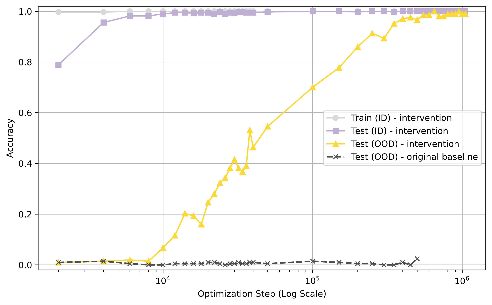
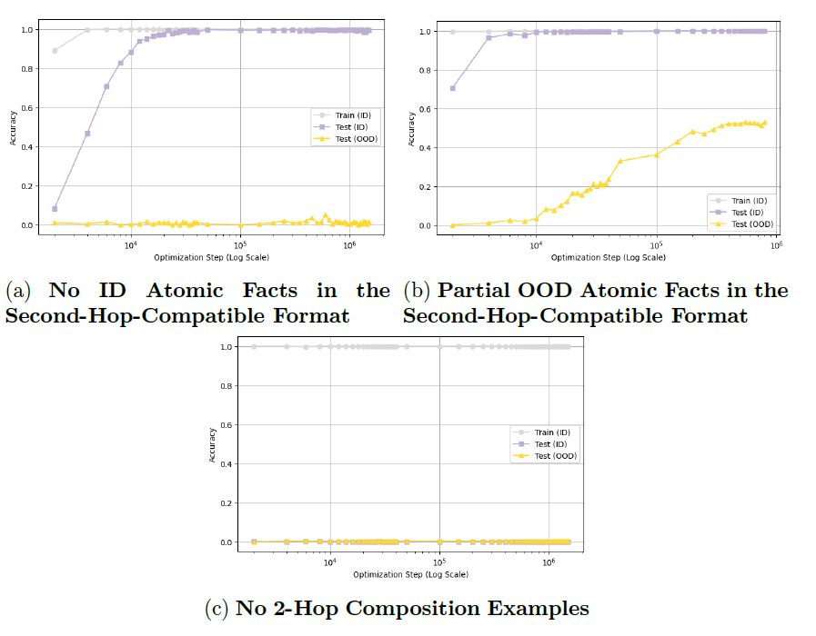

# Implicit Reasoning in Transformers

### Bridging the Compositionality Gap in GPT-2-like Models

**Davide Venuto** · Technical University of Denmark (DTU)  
**Leonardo Venuto** · Independent Researcher

**Can a Transformer combine facts it already knows to answer questions that require multiple reasoning steps?**

We investigate this question through *implicit two-hop reasoning*. We show that a simple change to **how atomic facts are presented during training** enables a GPT-2-like Transformer to transfer a learned compositional rule to OOD atomic facts previously seen only in isolation. In our controlled synthetic setting, OOD compositional accuracy rises from near zero under the original training distribution to nearly 100% after a delayed generalization phase, **without changing the architecture or adding OOD compositional training examples**.

<p align="center">
  
</p>

*Figure 1 · In the smaller, denser two-hop setting, position-aligned training enables OOD compositional generalization. Dashed gray: OOD accuracy under the original training distribution.*

## The problem: knowing facts is not enough

Consider two facts:

> **Barack's wife is Michelle.**  
> **Michelle was born in 1964.**

A model asked **“In which year was Barack's wife born?”** must find the intermediate entity *Michelle* and then retrieve *1964*. The intermediate answer is not given in the query.

Our experiments study this operation using synthetic entities and relations rather than natural-language biographies. In the notation of the paper:

```text
Known facts:       (h, r₁, b)  and  (b, r₂, t)
Composition rule:  (h, r₁, b) ∧ (b, r₂, t) ⇒ (h, r₁, r₂, t)
Model query:       (h, r₁, r₂)                → t
```

The model is trained on **all atomic facts**, but only a subset, designated as in-distribution (ID), appears in two-hop compositional training examples. The remaining facts, designated as out-of-distribution (OOD), are observed individually but never used in compositional training examples. The challenge is therefore **transferring the compositional rule learned from ID facts to OOD atomic facts**.

## The approach: align knowledge with the second hop

Prior mechanistic analyses of this task suggest that lower Transformer layers resolve the bridge entity, while upper layers retrieve the second-hop answer ([Wang et al., 2024](https://arxiv.org/abs/2405.15071)). This motivates a training-data hypothesis: atomic knowledge may need to be encountered in a configuration compatible with the computation that uses it.

We add a second-hop-compatible representation of **both ID and OOD atomic facts**:

```text
Original atomic sequence:       (b, r₂, t)
Additional aligned sequence:    (⟨m⟩, b, r₂, t)
```

Here, `⟨m⟩` is a positional placeholder. Each added sequence still represents one atomic fact. **The architecture stays fixed, and no OOD two-hop supervision is added.**

## Results: which conditions make transfer possible?

The full intervention produces delayed, near-complete OOD generalization in the **200-entity, 20-relation** setting. Controlled ablations isolate the ingredients associated with that transfer:

| Training condition | OOD compositional result |
| --- | --- |
| Shared aligned exposure for ID **and** OOD atoms | Complete generalization (*Figure 1 )|
| Aligned OOD atoms, but **no aligned ID** atoms | Transfer does not emerge (*Figure 2a )|
| Aligned ID atoms, **partial aligned OOD** coverage | Partial generalization in the smaller setting (*Figure 2b )|
| Aligned atoms, but **no two-hop training** | Neither ID nor OOD composition is learned(*Figure 2c )|


<p align="center">
  
</p>


*Figure 2 · The ablations show that alignment of OOD facts alone is insufficient: shared ID–OOD exposure and ID compositional supervision matter in this setting.*

The result is established on a controlled synthetic task. Additional experiments on a larger, sparser graph (2,000 entities and 200 relation types) suggest a similar generalization pattern, although convergence is slower and the model does not reach full accuracy within the available training budget.

## Research methods and implementation

[](https://www.python.org/)
[](https://pytorch.org/)
[](https://huggingface.co/docs/transformers/index)
[](src/Mechanistic_interpretability/causal_tracing_composition.py)
[](src/Mechanistic_interpretability/causal_tracing_composition.py)
[](scripts/Training_files_HPC/)

The experiments combine **controlled data generation, Transformer training, mechanistically motivated intervention design, ablation studies, and exact-match evaluation**. The original thesis project also includes **causal tracing / activation patching** and **layerwise logit-lens-style analysis** of Transformer computations. 

This repository contains the following curated structure. Dataset variants and the modified dependency packages are summarized at directory level:

```text
Data/
├── Data_Composition/                 # Composition datasets (42 variants)
└── data_composition_train_example.json
Research_Notebooks/
├── Data_Generation/
│   ├── composition.ipynb             # Position-aligned intervention generator
│   └── LICENSE
├── Experiments/
│   ├── EXPERIMENT_A..ipynb
│   └── EXPERIMENT_OOD.ipynb
├── Figures/
│   ├── Accuracy_Loss.ipynb
│   ├── t_sne.ipynb
│   ├── t_sne_CASO_A.ipynb
│   ├── t_sne_MASK.ipynb
│   └── visualization.ipynb
└── Final_notebook.ipynb
assets/
├── figure1_with_baseline.png
└── tree_controlled_ablation_figures.png
scripts/
├── Training_files_HPC/
│   ├── myjob_MASK_B_ID_OOD.sh
│   └── myjob_mask_B.sh
└── causal_tracing/
    └── A_myjob_causal_T.sh
simpletransformers/                  # Modified SimpleTransformers dependency
src/
├── Mechanistic_interpretability/
│   └── causal_tracing_composition.py # Adapted causal tracing / logit lens
├── Figures_my.py                    # Plotting helpers
├── eval_qa.py                       # Evaluation of saved predictions
├── inference_script.py
├── inference_utils.py
├── main.py
├── main_multy_GPU.py                # Model training
└── utils.py
transformers/                        # Modified Transformers dependency
.gitignore
README.md
```

The full [thesis research codebase](https://github.com/Davide011/Thesis_public) contains the additional experiments and artifacts outside this selection.

## Paper and acknowledgments

**Davide Venuto and Leonardo Venuto.** *Implicit Reasoning in Transformers: Bridging the Compositionality Gap in GPT-2-like Models.* [Public manuscript link to add when available].

This work builds on the controlled setup and earlier circuit analysis in **Wang et al. (NeurIPS 2024)**, [*Grokked Transformers are Implicit Reasoners*](https://arxiv.org/abs/2405.15071). The position-aligned training intervention and ablation experiments presented here are distinct from that baseline.
